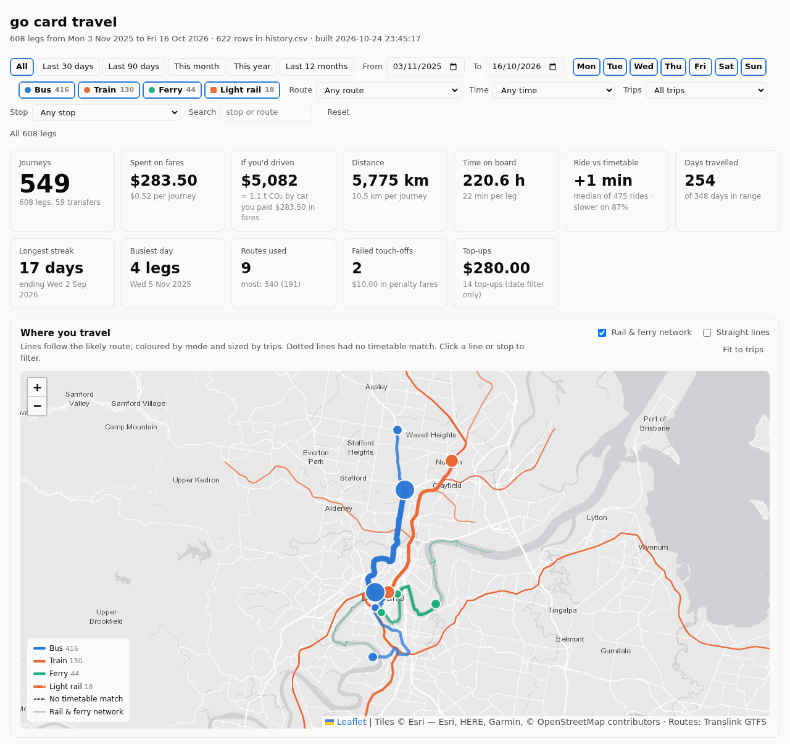
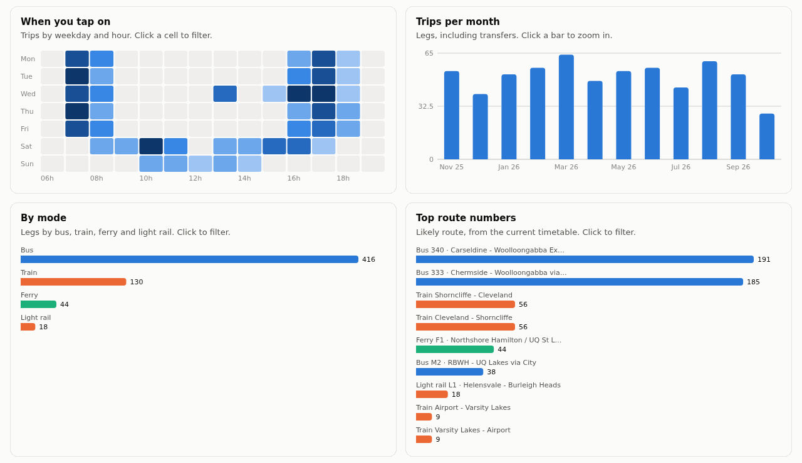
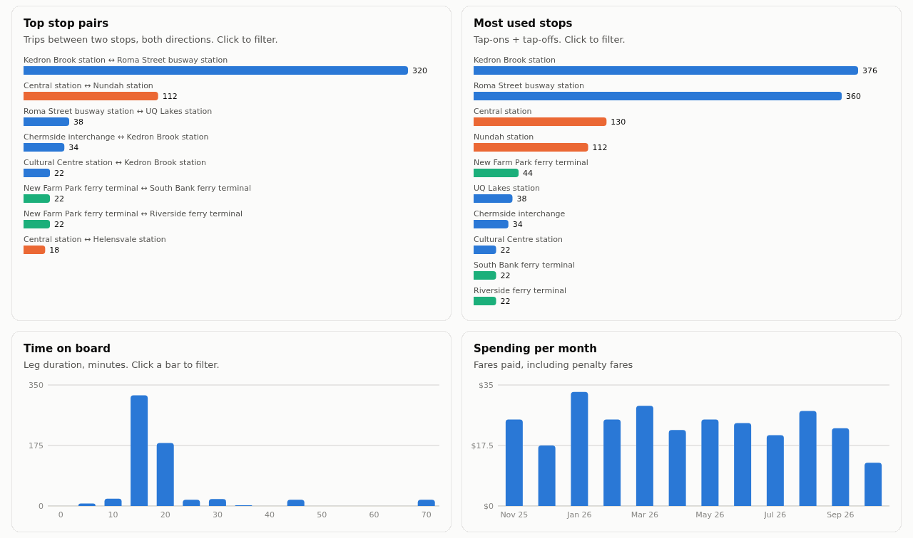
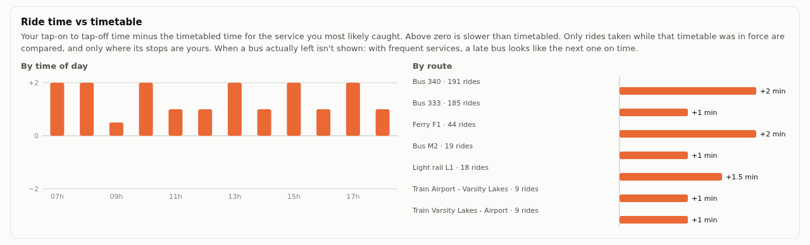
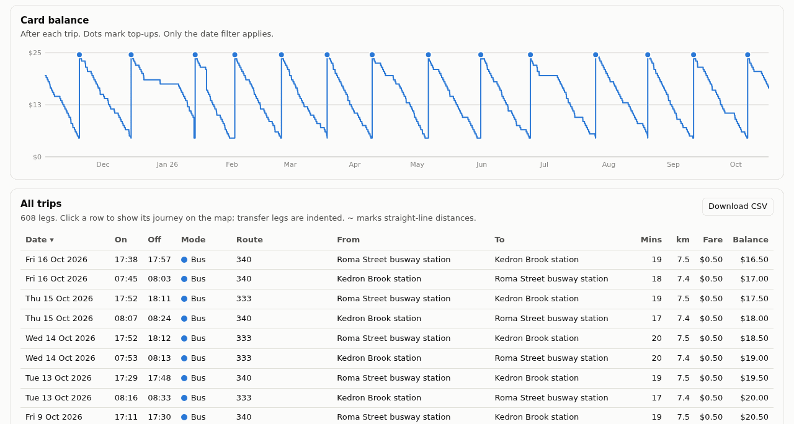
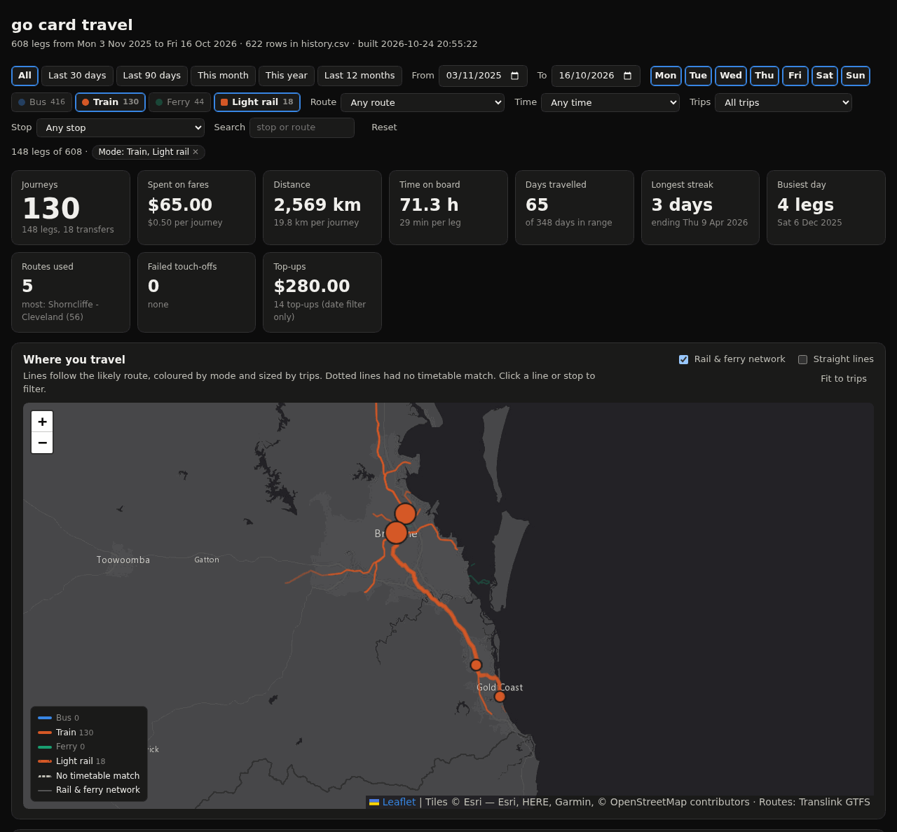

# translink-gocard-dashboard

[](https://github.com/bwenstar/translink-gocard-dashboard/actions/workflows/tests.yml)

Download your [Translink](https://translink.com.au) go card travel history and explore it
on a local dashboard: trips on a map, a calendar, when you travel, top routes, time on board,
card balance and a searchable trip table.

go card online only exports **6 months at a time**. This project gets around that by splitting
any date range into 6-month windows, downloading each one, and merging them into a single master
file (`data/history.csv`) with overlaps removed. You can download as far back as your card's
history goes and then just fetch what's new.

Everything runs locally. Your card number, password and travel history stay on your machine and
are gitignored.

**[▶ Try the live demo](https://bwenstar.github.io/translink-gocard-dashboard/)**: the full dashboard
with fictional example data. Nothing to install.



<sub>Screenshots use the fictional example data in [`examples/`](examples/), not a real person's travel.</sub>

<details>
<summary><b>More screenshots</b></summary>

**When you travel, by mode and route:** every chart is clickable to filter.


**Stops, durations and spending**


**Ride time vs timetable:** how much slower or faster rides were than timetabled, by hour and by route.


**Card balance and every trip:** sortable, with likely route and distance, and exportable to CSV.


**Dark mode, filtered to train + light rail:** a Gold Coast day trip on the rail network layer.


</details>

## Features

- **Automated download** from go card online with your card number and password. It uses plain
  HTTP requests, so no browser is needed.
- **Any date range**: `--years 6`, `--from/--to`, or `--all` to walk back to your first trip.
- **One master file**: every download is merged into `data/history.csv` with no double counting.
  A trip that was still open in an earlier download is updated once it completes.
- **Import manual exports**: merge CSVs you downloaded from the website yourself.
- **Stop geocoding**: go card stop names are matched to Translink's public GTFS stop list. Matching
  is fuzzy but platform-aware, and anything uncertain is flagged for you to check.
- **Route paths and route numbers**: each trip is matched against Translink's timetable to find
  the service you most likely caught. The map draws its real path along the roads, busway, rail
  line or river, and the trip table shows the route number.
- **Every mode**: bus, train, ferry (CityCat and cross-river) and light rail (G:link) are detected,
  coloured and filterable. A mode you haven't used yet still shows up, with zero trips.
- **Static dashboard**: open `dashboard/index.html` straight from disk. There's no server and no
  build tooling, and it supports light and dark mode.
  - KPIs: journeys, fares, distance travelled, time on board, days travelled, longest daily
    streak, busiest day, routes used, failed touch-offs, top-ups, and **"If you'd driven"**: the
    cost and CO₂ of driving the same distance instead
  - **map**:
    - trips drawn along their real route path, coloured by mode and sized by use
    - an optional layer showing the whole rail and ferry network
    - a mode legend, a straight-line toggle and a "fit to trips" button
    - click a line or stop to filter
  - **charts**:
    - trips-per-day calendar, weekday × hour heatmap, weekly/monthly trips
    - legs by mode, top route numbers, top stop pairs, most used stops
    - trip durations, spending per month, card balance with top-ups
    - **ride time vs timetable**: how much longer or shorter your rides take than timetabled, by
      time of day and by route (see [How it works](#how-it-works) for what is and isn't measured)
  - **filters**:
    - date range and presets, weekdays, mode, route number, time of day
    - trip type (with a transfer, failed touch-off, no route match, unverified stop)
    - stop, and a free-text search
  - **every chart is clickable**: a heatmap cell filters to that weekday and hour, a bar zooms
    to that week or month, and a route, stop or stop pair filters to it. Active filters show as
    removable chips.
  - filters are saved in the URL, so a filtered view can be bookmarked
  - a sortable trip table with mode, route, distance and fare. Click a row to show that journey
    on the map. **Download CSV** exports exactly the trips you've filtered to.

## Requirements

- Python 3.10+
- [`requests`](https://pypi.org/project/requests/) (`pip install -r requirements.txt`)
- A go card registered for go card online, with a password

## Try it without an account

The repo includes a year of example travel for a fictional commuter: busway to work, train some
days, weekend CityCats and a monthly Gold Coast trip by train and light rail. Every trip is a real
timetabled service.

```bash
pip install -r requirements.txt
python3 scripts/fetch_gtfs.py        # Translink's public timetable (~35 MB)
python3 scripts/build.py --demo      # builds dashboard/data.js from examples/
xdg-open dashboard/index.html
```

Run `python3 scripts/build.py` without `--demo` later to switch to your own data.

The [live demo](https://bwenstar.github.io/translink-gocard-dashboard/) is this same build. On each
push that changes the dashboard, scripts or examples, `.github/workflows/pages.yml` downloads the
public timetable, runs `build.py --demo` and publishes the result to GitHub Pages. It only ever uses
`examples/`. A fork can host its own demo: in **Settings → Pages**, set the source to
**GitHub Actions**.

## Quick start

```bash
git clone <this repo> && cd <repo>
pip install -r requirements.txt

cp .env.example .env && chmod 600 .env   # then fill in your card number (and password)
make update                        # downloads the timetable and your whole history, builds the dashboard
make serve                         # open http://localhost:8000
```

No `make` (e.g. on Windows)? Every target is one command, so run `python3 scripts/update.py`,
then open `dashboard/index.html`. The individual steps are under [Usage](#usage).

The first build takes about a minute: it matches every stop you've used to Translink's stop list
and looks up route paths. After that, builds take under a second. Check the stop guesses it prints
(see [Checking stop matches](#checking-stop-matches)).

### `.env`

```ini
# your 16-digit go card number
USERNAME=0123456789012345
PASSWORD=your-go-card-online-password
```

`GOCARD_CARD` / `GOCARD_PASSWORD` also work, in `.env` or as environment variables. `USERNAME` is
only read from `.env`, never from the environment, where it's usually your OS login name.

**Rather not store your password?** Leave `PASSWORD` out of `.env`, or run with `--ask`.
`fetch_history.py` will prompt for it each run, and it's held in memory only for that run.

**More than one go card** (yours and a partner's, say)? Add each extra card with a number, and
optionally a label for the dashboard:

```ini
USERNAME_2=0123456789012345
PASSWORD_2=its-go-card-online-password
CARD_NAME_2=Partner
CARD_NAME=Me        # optional label for card 1
```

`make update` then logs in to each card in turn, a few seconds apart, and keeps each card's
history in its own file: card 1 in `data/history.csv`, card *N* in `data/history.cardN.csv`, with
raw copies in `data/raw-cardN/`. Each card has its own login pause, so a wrong password on one
card doesn't stop the others updating. The dashboard gets card filter buttons, a Card column,
and one balance line per card. Journeys and transfers are worked out per card. To download a
single card by hand: `fetch_history.py --card 2`.

## Usage

### Download history: `scripts/fetch_history.py`

| Command | What it downloads |
|---|---|
| `fetch_history.py` | **Incremental** (default): from a week before the newest trip in the master file to today |
| `fetch_history.py --all` | Walks back from today until two 6-month windows in a row are empty |
| `fetch_history.py --years 6` | The last N years |
| `fetch_history.py --from 2024-01-01 --to 2025-06-30` | An explicit range of any length (`YYYY-MM-DD` or `DD/MM/YYYY`; `--to` defaults to today) |
| `fetch_history.py --import PATH [PATH ...]` | No download: merges CSV files or folders you exported by hand |
| `fetch_history.py --check-site` | No download: checks the site still works as recorded in `docs/site-contract.json` (see [If the site changes](#if-the-site-changes)) |

Options:

| Option | Default | |
|---|---|---|
| `--history` | `data/history.csv` | master file to merge into |
| `--raw` | `data/raw` | where a backup copy of each download is saved, as `<YYMMDD>-<YYMMDD>/Travel_history.csv` |
| `--no-raw` | | don't keep backup copies |
| `--env` | `.env` | credentials file |
| `--card` | `1` | which card to download (`2` uses `USERNAME_2`/`PASSWORD_2`, and so on) |
| `--ask` | | prompt for the password instead of reading it from `.env` |

Each window is merged and saved as soon as it's downloaded, so an interrupted run keeps what it got.

### Build the dashboard: `scripts/build.py`

Reads `data/history.csv` and writes `dashboard/data.js`. Run it after every download.

| Option | Default |
|---|---|
| `--history` | `data/history.csv` |
| `--stops` | `data/stops.json` (created automatically) |
| `--gtfs` | `data/gtfs/stops.txt` |
| `--gtfs-zip` | `data/gtfs/SEQ_GTFS.zip`. Full feed used for route paths; without it, lines are straight |
| `--demo` | use `examples/history.csv` and `examples/stops.json` |
| `--out` | `dashboard/data.js` |

### Stop coordinates: `scripts/fetch_gtfs.py`

Downloads Translink's public [SEQ GTFS feed](https://gtfsrt.api.translink.com.au/GTFS/SEQ_GTFS.zip)
(about 35 MB) into `data/gtfs/`. It keeps the whole zip for route paths and extracts `stops.txt`
and `routes.txt`. Run it once, and again every so often to pick up timetable changes or new stops.

### Checking stop matches

go card stop labels (`Chermside interchange - Stop B`) don't match GTFS names, so
`build.py` guesses a GTFS stop for each new name and saves it to `data/stops.json`:

```json
"Chermside interchange - Stop B": { "stop_id": "3932" },
"Some Stop - Arrival": { "stop_id": "3956", "auto": true, "score": 0.52 }
```

Entries with `"auto": true` are guesses. **`make review-stops`** (`python3 scripts/review_stops.py`)
checks them for you against the timetable. For each guess it looks at which timetable stop your
matched services actually used nearby, and reports *confirmed*, *suggest* (with the better stop)
or *check* (nothing to go on). `make review-stops ARGS=--apply` saves the confirmations and any
correction backed by 2+ rides, keeping a backup in `data/stops.json.bak`.

Guesses are also printed by the build and flagged on the dashboard's map and table. To check one
by hand, look the stop up in `data/gtfs/stops.txt` or on a map, correct the `stop_id` if needed,
and delete `auto` and `score`. Your corrections are kept on later
builds. See `data/stops.example.json` for the format.

## Keeping it up to date

```bash
make update          # or: python3 scripts/update.py
```

One command does it all:
1. downloads new trips (from a week before your newest one);
2. refreshes Translink's timetable if it's more than 30 days old. If there are new trips, it first
   builds once with the old timetable, so rides from its last days are still compared with the
   timetable they were ridden under (see [How it works](#how-it-works));
3. rebuilds the dashboard.

On a first run it imports `data/raw/` if you have exports there, or downloads your whole history.
Each run appends to `data/update.log` and writes `data/last-update.json` (when, whether it worked,
how many new rows). It also writes `dashboard/status.js`, so the dashboard header says "updated 3 days
ago". A red banner appears when the last run failed (even though that run didn't rebuild the dashboard)
or when there's been no update for more than 10 days.
Once `data/update.log` or `data/cron.log` grows past 1 MB, the next run cuts it down to its newest
half, starting at a run boundary, so the logs can't fill a small SD card (`--log-max-kb` to change it).

### Run it weekly

```bash
make schedule        # install a weekly timer (Mondays 07:00); make schedule-status / make unschedule
```

- **Linux:** a systemd *user* timer, so no root is needed. A run missed while the computer was off
  happens at the next start. User timers run while you're logged in; `loginctl enable-linger`
  lets them run when you're not.
- **Elsewhere:** `make schedule` prints a crontab line to add. On Windows, point Task Scheduler at
  `python scripts\update.py`.
- **Another time:** `python3 scripts/schedule.py install --when "Sun *-*-* 20:00"`. Any systemd
  calendar expression works.

### When something goes wrong

Failures exit non-zero and send a **desktop notification** (`notify-send` on Linux, Notification
Center on macOS) that says what kind of failure it was:

| Failure | What it means | What to do |
|---|---|---|
| `login` | wrong card number or password | Fix `.env`. **Automatic runs pause** until `.env` changes, so a wrong password is never retried week after week. `update.py --force` overrides the pause. |
| `site-changed` | go card online no longer matches `docs/site-contract.json` | `make check-site`, then see [If the site changes](#if-the-site-changes) |
| `network` | the site was down or slow | nothing; the next run tries again |
| `error` | anything else | see `data/update.log` |

For alerts somewhere else, such as your phone, give it a command (or set `GOCARD_NOTIFY_CMD`):

```bash
python3 scripts/update.py --notify-cmd 'curl -s -d "$GOCARD_MESSAGE" ntfy.sh/your-private-topic'
```

The command gets `GOCARD_STATUS` (`ok`/`failed`), `GOCARD_KIND` and `GOCARD_MESSAGE`. Add
`--notify-success` to hear about successful runs too.

### Run it on an always-on machine (Raspberry Pi, home server)

A desktop isn't on all the time, so a small always-on machine can do the weekly download and
serve the dashboard to your other devices. Your data stays on that machine; nothing goes online.
It's tested on a Raspberry Pi 3 (1 GB, 32-bit Raspberry Pi OS). There, a build takes about
4 seconds, and the monthly timetable refresh (which recomputes route paths) about 100 seconds
using under 200 MB of memory. Docker isn't needed; the system Python and `python3-requests`
are enough.

1. **Copy it over.** Clone the repo on the machine. Then copy `.env` (and `chmod 600` it) and,
   if you already have them, `data/history.csv`, `data/stops.json` and `data/gtfs/`, using
   `scp` or `rsync` over your own network. Without them, the first `make update` downloads
   everything.
2. **Set a dashboard password** in that machine's `.env`:

   ```ini
   DASHBOARD_USER=gocard
   DASHBOARD_PASSWORD=<something long and random>
   ```

3. **Schedule the update** with `crontab -e`:

   ```cron
   10 7 * * 1 cd /path/to/repo && /usr/bin/python3 scripts/update.py --no-desktop >> data/cron.log 2>&1
   ```

4. **Serve the dashboard** with a systemd service. Put this in
   `/etc/systemd/system/gocard-dashboard.service`, then run
   `sudo systemctl enable --now gocard-dashboard`:

   ```ini
   [Unit]
   Description=go card travel dashboard
   After=network-online.target
   Wants=network-online.target

   [Service]
   User=<you>
   WorkingDirectory=/path/to/repo
   ExecStart=/usr/bin/python3 scripts/serve.py --host 0.0.0.0 --port 8765
   Restart=on-failure
   NoNewPrivileges=true
   ProtectSystem=strict
   ProtectHome=read-only
   PrivateTmp=true

   [Install]
   WantedBy=multi-user.target
   ```

   Then open `http://<machine>:8765/` from any device on your network. The browser asks for the
   dashboard user and password.

`scripts/serve.py` refuses to listen beyond localhost without `DASHBOARD_PASSWORD`, never lists
directories, and only serves `dashboard/`. **Keep the port private:** use your home network or a
VPN like Tailscale, and don't port-forward it or put it behind Tailscale Funnel or similar, which
would publish your travel history. The password is sent with every request over plain HTTP, which
is fine on your own network but not over the internet.

To update the code later: `git pull`, then `sudo systemctl restart gocard-dashboard`.

### Other shortcuts

| Command | Does |
|---|---|
| `make serve` | serves the dashboard at <http://localhost:8000> |
| `make build` | rebuilds `dashboard/data.js` only |
| `make review-stops` | checks the stops `build.py` guessed against the timetable (`ARGS=--apply` to save) |
| `make demo` | builds from the fictional example data |
| `make check-site` | checks go card online still works as recorded |
| `make gtfs` | re-downloads Translink's timetable |
| `make test` | runs the tests |

## Project layout

```
.env                        your credentials (gitignored)
.env.example                template for .env
requirements.txt
Makefile                    shortcuts: make update, serve, schedule, test, ...
README.md                   this file
PLAN.md                     roadmap and implementation notes
scripts/
  fetch_history.py          log in, download in 6-month windows, merge into history.csv
  history.py                master file: parse, merge/de-dupe, save
  update.py                 one command: refresh timetable, fetch new trips, rebuild (make update)
  schedule.py               install/remove the weekly timer (make schedule)
  build.py                  history.csv -> dashboard/data.js, stop matching
  review_stops.py           check build.py's stop guesses against the timetable (make review-stops)
  routes.py                 likely route per trip and its path, from the GTFS timetable
.github/workflows/
  tests.yml                 runs the tests on every push
  pages.yml                 publishes the demo (example data only) to GitHub Pages
docs/
  screenshots/              README images (from the example data)
  site-contract.json        how go card online works (login form, export, CSV format), checked every run
tests/                      unit tests (python3 -m unittest discover tests); no network needed
  fakes.py                  a tiny made-up GTFS feed and a fake go card online site
  fetch_gtfs.py             Translink GTFS stop list
  make_example.py           regenerates examples/ from the timetable (fictional commuter, seeded)
  make_screenshots.py       regenerates docs/screenshots/ from the example data (headless Chrome)
examples/
  history.csv, stops.json   fictional example data for --demo and the screenshots
data/                       everything here is gitignored except stops.example.json
  history.csv               master travel history (history.cardN.csv for card N)
  raw/                      backup copy of every download (raw-cardN/ for card N)
  stops.json                your stop name -> GTFS stop_id map (gitignored)
  stops.example.json        format example
  gtfs/                     GTFS feed and route-path cache (gitignored)
  site-snapshots/           private raw pages saved by --check-site (gitignored)
dashboard/
  index.html, app.js, style.css
  data.js                   generated from your history (gitignored)
```

## How it works

**Downloading.** Login is a form `POST` to `/webtix/welcome/welcome.do` with your card number and
password. The CSV export is
`/webtix/cardinfo/history.do?csvExport=yes&startDate=DD/MM/YYYY&endDate=DD/MM/YYYY`. Ranges longer
than about 6 months come back with no rows, so requests use 180-day windows. The script is careful with
your account: one session per run, a 2-second pause between requests, and it **never retries a
failed login**, so a wrong password can't lock you out.

**Merging.** Each row is identified by its touch-on: date, time and stop, plus a count for genuine
repeats in the same minute. A row seen again is ignored if it's unchanged and updated if it changed.
A completed trip is never replaced by an open one.

**Parsing.** The export has quirks that `build.py` handles:
- a duplicate `Time` header
- 24-hour times with a redundant suffix (`17:20 PM`)
- money like `$ 0.50`
- transfer legs (`(Touch on Transfer)`)
- top-up rows: `Auto top up(...)` and driver top-ups (`Top Up(... Depot)`, where one row is both
  the top-up and a trip)
- adjustments
- failed touch-offs, including penalty rows with no time or stop

Transfer legs are grouped into journeys.

**Route paths.** For each tap-on/tap-off stop pair, `routes.py` searches the GTFS `stop_times.txt`
for trips that call at the tap-on stop and later at the tap-off stop. Stops within 200 m also count,
which covers station platforms. Each trip takes the service whose departure is nearest the tap-on
time on the same weekday. That trip's shape (`shapes.txt`) is cut between the two stops and
simplified. The first build takes about 10 seconds. Results are cached in
`data/gtfs/paths_cache.json`, so later builds take under a second until the feed or your stops change.

**Modes.** Each leg takes the mode of its matched GTFS route (bus 3, rail 2, ferry 4, light rail 0).
Unmatched legs fall back to the stops: ferry terminals and train stations are recognised from
their GTFS ids and names. Rail replacement buses in the timetable are ignored. A bus match between
two train stations is only accepted if no train fits. The network layer is one shape per rail,
ferry and light rail route, simplified to about 25 m.

**Ride time vs timetable.** Each routed ride is compared with the scheduled stop-to-stop time of
the service it was matched to: tap-off minus tap-on, minus the timetabled minutes. Two rules keep
it honest:
- **Only rides taken while that timetable was in force are compared.** An older ride compared
  with today's timetable mostly measures how the network has changed since (routes are
  re-routed, stops move, peak timetables get re-padded). Because Translink publishes a new
  timetable every few weeks, results are saved in `data/timetable-checks.json` and kept after
  the timetable moves on. Run `make update` regularly (the weekly timer does) and they build up.
- **Only when the timetable's stops are within 100 m of yours.** A nearby stop on a different
  path would compare different journeys.

When a bus actually *departed* isn't measured. Rides are matched to the nearest timetabled
departure, so with services every few minutes a late bus is indistinguishable from the next one
running on time. The demo compares all its rides, because its fictional trips were generated
from the current timetable.

**"If you'd driven."** The same distance in an average Australian car, as an estimate:
- **cost:** the [ATO cents-per-km rate](https://www.ato.gov.au/individuals-and-families/income-deductions-offsets-and-records/deductions-you-can-claim/cars-transport-and-travel/motor-vehicle-and-car-expenses/claiming-car-expenses/cents-per-kilometre-method)
  for 2025–26, 88 c/km. It covers fuel, registration, insurance, servicing, tyres and
  depreciation, but **not parking**, which in the CBD can cost more than all of that.
- **CO₂:** the [National Transport Commission](https://www.ntc.gov.au/)'s average for Australia's
  whole light-vehicle fleet, 190.8 g/km (2025 report).

Distances are along your route, which a car's may differ from. Your share of the bus, train or
ferry's own emissions isn't subtracted. Published figures for that depend heavily on how full
the vehicle is, so there's no fair number to use; the tile says CO₂ "by car", not "saved". To use
your own car's figures, change `CAR` at the top of `dashboard/app.js`.

**Dashboard.** Plain HTML, CSS and JS with hand-drawn SVG charts and [Leaflet](https://leafletjs.com)
for the map. Modes use three colour-blind-checked colours (bus blue, rail orange, ferry aqua).
Light rail shares the rail colour with a dashed line, because a fourth colour can't be told apart
reliably. Map tiles are Esri World Gray Canvas, which needs no API key and works from `file://`.

## Security & privacy

This is a local tool. There is no server, account or analytics, and nothing is uploaded anywhere.
Don't just take that on trust: the code is short enough to check.

### Your go card credentials

- They are read in one place, `credentials()` in `scripts/fetch_history.py`, and sent in one
  place, `login()`: a single HTTPS `POST` to `https://gocard.translink.com.au/webtix/welcome/welcome.do`,
  the same form the website uses.
- After logging in, the script checks it's still on `gocard.translink.com.au` and stops otherwise.
- They are never printed or logged (only the card's last 4 digits are shown), never written to
  any other file, and never sent to any other site.
- One login attempt per run. A failed login stops immediately rather than retrying, so a wrong
  password can't lock your card. The script logs out when it finishes.
- `.env` is gitignored. The script warns if it's readable by other users (`chmod 600 .env`).
  It also refuses to run with the placeholder card number from `.env.example`.
- To avoid storing the password at all, use `--ask` (see above).
- Use a go card password you don't use anywhere else. If you think it's been exposed, change it
  on the go card website, which makes the old one useless.

To audit it yourself, list every network call in the project:

```bash
grep -rnE "https?://|requests\.|urlopen" scripts dashboard
```

### Every network request the project makes

| From | To | What's sent | Why |
|---|---|---|---|
| `fetch_history.py` | `gocard.translink.com.au` | card number + password (login), date ranges | download your history |
| `fetch_gtfs.py` | `gtfsrt.api.translink.com.au` | nothing personal (plain download) | public timetable and stop data |
| dashboard (browser) | `unpkg.com` | nothing personal | the Leaflet map library, pinned with integrity hashes |
| dashboard (browser) | `server.arcgisonline.com` (Esri) | which map tiles to draw | background map |

Your trip data (`data.js`) is read by the browser from disk and never leaves your computer. If
you run `scripts/serve.py` on a home server, it goes only to browsers on your network that have
the dashboard password (see [Run it on an always-on machine](#run-it-on-an-always-on-machine-raspberry-pi-home-server)).
The one thing worth knowing: map tile requests reveal to Esri which area you're looking at, like
any web map. `build.py`, `history.py` and `routes.py` make no network requests.

### Personal files

Everything in `data/` is gitignored except `data/stops.example.json`, so new personal files
there are private by default. These are the personal files, and none of them should be committed:

| File | Contains |
|---|---|
| `.env` | card number and password |
| `data/history.csv`, `data/raw/` | every trip you've taken |
| `data/stops.json` | the stops you use, which reveal roughly where you live and work |
| `dashboard/data.js` | all of the above, compiled |
| `data/gtfs/paths_cache.json` | the stop pairs you travel between |
| `data/site-snapshots/` | raw go card online pages, including your card details and balance |
| `data/timetable-checks.json` | your ride times compared with the timetable |
| `data/update.log`, `data/last-update.json`, `data/cron.log` | what each update did, including the last 4 digits of your card |
| `dashboard/status.js` | how the last update went (time, error message, card names) |

Before pushing a fork, check `git status` and
`git log --all --name-only --format= | grep -v '^examples/' | grep -E "\.csv$|\.env$|data\.js$|stops\.json$"`.
The second command should print nothing. Also check your own notes and commit messages for stop
names or card digits before publishing a fork.

## Tests

```bash
python3 -m unittest discover tests
```

Over 100 tests, runnable in under a second. They need no network, go card account or Translink
download: the go card website and the timetable are replaced by fakes in `tests/fakes.py`, a tiny
made-up town with a bus, train, rail replacement bus, ferry and light rail. GitHub Actions runs
them on every push (Python 3.10 and 3.14).

| File | Covers |
|---|---|
| `test_fetch_history.py` | `.env` reading, which credentials win, the password prompt, the `.env` permission warning, 180-day windows. Login never posts to an unrecognised form, never retries and stops on a redirect. Export stops on HTML or changed columns. Full `--all`, incremental, `--years`, `--from/--to`, `--import` and `--check-site` runs against the fake site. |
| `test_routes.py` | Picks the nearest departure on the same weekday, trains beat buses between stations, ignores rail replacement buses, cuts paths at the stops, uses the cache, builds the network layer |
| `test_build.py` | Times, stop-name tokens, stop matching from scratch (picks the right one of two same-named streets), stop modes, and a full build on the fake feed |
| `test_parsing.py`, `test_history.py` | Every CSV row type, money formats, merging and de-duplicating downloads, master file ordering |
| `test_make_example.py` | The example generator: real-looking CSV, consistent balances, same output for the same seed |
| `test_cards.py` | Several go cards: `.env` numbering and labels, card 2 logging in with its own credentials into its own files, `make update` fetching each card then building once, one card's failed login pausing only that card, and journeys never chaining across cards |
| `test_review_stops.py` | Stop review: guesses are confirmed (including a station whose platforms were used), corrected only with 2+ agreeing rides, mixed or missing evidence is left for you, and a dry run changes nothing |
| `test_serve.py` | The dashboard server: the right user and password are needed, it won't serve on the network without a password, never lists directories, and can't be tricked into serving files outside `dashboard/` |
| `test_update.py` | `make update`: step order, first runs, the timetable refresh. A failed login pauses later runs until `.env` changes. Failure kinds match fetch_history's real messages, crashes are still notified, only one run at a time, the notify command and the timer units. |

The safety rules are checked against deliberate breakage. Disabling any one of them (the login-form
check, the host check, the CSV column check, the 180-day limit, the rail-replacement filter, the
station penalty, the weekday filter, the "never revert a completed trip" rule, and others) makes
at least one test fail.

## If the site changes

This project depends on go card online's website, which Translink can change at any time. To make
that easy to spot and fix:

- **`docs/site-contract.json`** records exactly what the code relies on: the login form's address
  and fields, the export address and its parameters, the 6-month limit, the CSV columns and the
  formats of every row type. It's a structural description, not a copy of Translink's pages.
- **Every run checks it.** Before sending your credentials, `fetch_history.py` checks the login
  form still has the expected fields, so it never types your password into a form it doesn't
  recognise. Every download's CSV columns are checked too. On a mismatch it stops and says exactly
  what changed, e.g. `login form has new fields: csrf (a captcha or token?)`. It never silently
  saves bad data.
- **`fetch_history.py --check-site`** runs the full check without downloading anything: login form,
  login, history page, a one-week export, and whether the 6-month limit still applies. It also
  saves the raw pages to `data/site-snapshots/<date>/`. They're private and gitignored because they
  include your card details. Run it after a failure, or now and then, so whoever fixes the project
  later can compare old and new pages.
- **Tests** (see [Tests](#tests)) cover every row type and the site checks, using made-up sample
  data, so the parser can be changed safely.

To fix a break: run `--check-site`, compare the new pages with an old snapshot, update
`fetch_history.py` (and `build.py` if the CSV changed) and `docs/site-contract.json` together.
Then run the tests. If go card online disappears entirely, you can still export CSVs by hand from
whatever replaces it and use `--import`. Everything you've already downloaded stays in
`data/history.csv`.

## Limitations

- The ride-time comparison starts from your first ride under the timetable you downloaded, so it's
  empty at first and builds up with each update. Departure punctuality isn't measured at all
  (see [How it works](#how-it-works)).
- Works for anyone with a go card online account in South East Queensland: nothing in the code is
  specific to one person. Stops are matched from scratch for each user (check the guesses the
  build prints).
- One go card per login: go card online shows a single card per session, so several cards mean
  several logins (handled for you; see [`.env`](#env)).
- History only goes back as far as go card online keeps it for that card. A replacement card starts
  a new history.
- Trips you started by topping up with the driver have no recorded boarding stop. They show as
  "Unknown stop".
- Routes come from Translink's **current** timetable, so for older trips they are a best guess.
  If no current service links two stops (for example the route was changed or removed), the trip
  is drawn as a dashed straight line.
- This uses go card online's website, not a public API. It may break if Translink changes the site.

## Roadmap

See [PLAN.md](PLAN.md#future-work) for the full list. Next up:
- a licence, backups of the always-on machine's data, and update health on the dashboard
- real departure punctuality from Translink's public live feeds
- historical timetables, so old trips match the network as it was

## Disclaimer

This is an unofficial personal project, not affiliated with or endorsed by Translink or the
Queensland Government. Use it only with your own go card account.
